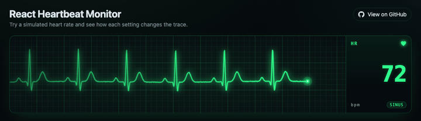
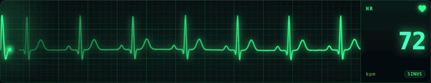

# React Heartbeat Monitor

A React component that draws a simulated heartbeat on a canvas. Set the heart rate in BPM, change the colors, or pause the trace.

Turn off **Readout** and **Grid** in the demo to show just the trace. You can also change the label in the readout.

**[Try the interactive demo](https://phillippbertram.github.io/react-heartbeat-monitor/)**


## Use it in your app

Copy [`src/HeartbeatMonitor`](src/HeartbeatMonitor) into a React 18+ project that supports TypeScript and CSS imports. Keep a copy of the [MIT license](LICENSE) with the files.

```tsx
import { HeartbeatMonitor } from './HeartbeatMonitor';

export function PulsePreview() {
  return <HeartbeatMonitor bpm={72} color="#22d3ee" />;
}
```

See the [component guide](src/HeartbeatMonitor/README.md) for props, CSS variables, and custom waveforms.



<details>
<summary>See the status examples</summary>




</details>

## Run the demo locally

With Node.js 24, run the commands below and open `dist/index.html` in your browser.

```sh
npm ci
npm run build
```

Run `npm run typecheck` to check the TypeScript code. The demo uses Tailwind CSS, and the component comes with its own stylesheet.

## License

[MIT](LICENSE)
