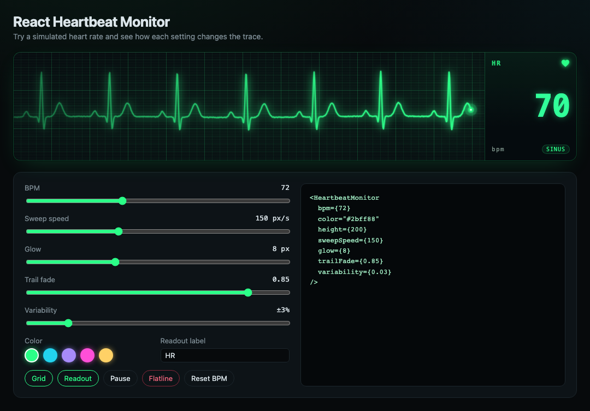
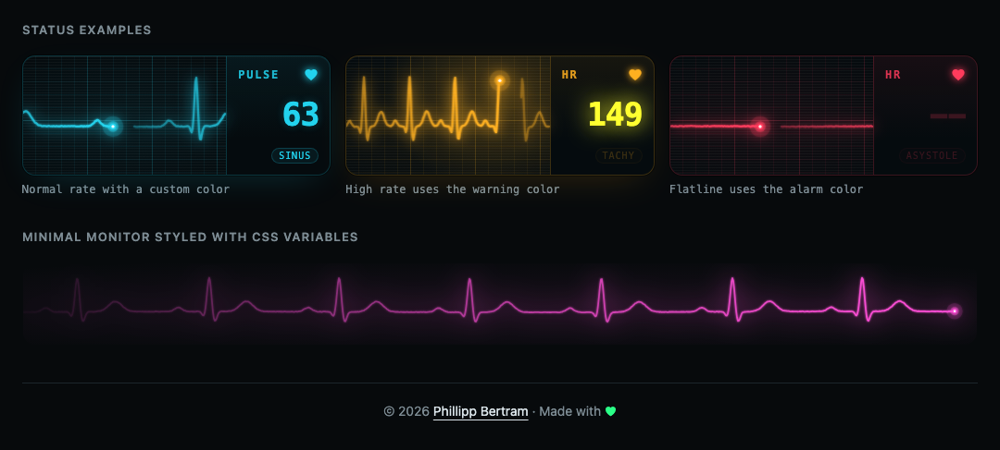

# React Heartbeat Monitor

A React component that draws a simulated heartbeat on a canvas. Set the heart rate in BPM, change the colors, or pause the trace.

Turn off **Readout** and **Grid** to show just the trace. Under **Flatline color**, keep the default red with `alarmColor` unset, match the normal color, or pick a custom color. Click a status example to load its settings into the interactive monitor.

Use **Appearance** to change the height, line width, border, background glow, beat pulse, scanlines, and background transparency. Under **Status examples**, **Load minimal preset** fills in those settings and updates the JSX example.

**[Try the interactive demo](https://phillippbertram.github.io/react-heartbeat-monitor/)**



## Use it in your app

Copy [`src/HeartbeatMonitor`](src/HeartbeatMonitor) into a React 18+ project that supports TypeScript and CSS imports. Keep a copy of the [MIT license](LICENSE) with the files.

```tsx
import { HeartbeatMonitor } from './HeartbeatMonitor';

export function PulsePreview() {
  return <HeartbeatMonitor bpm={72} color="#22d3ee" />;
}
```

See the [component guide](src/HeartbeatMonitor/README.md) for props, CSS variables, and custom waveforms.


<details>
<summary>See the status examples</summary>




</details>

## Run the demo locally

With Node.js 24 and pnpm, install the dependencies and start the development server.

```sh
pnpm install
pnpm dev
```

Open the local URL printed in the terminal. React and CSS changes appear as you edit. Press `Ctrl+C` to stop the server.

Run `pnpm build` to create a standalone `dist/index.html` you can open directly in your browser. Run `pnpm typecheck` to check the TypeScript code. The demo uses Tailwind CSS, and the component comes with its own stylesheet.

## License

[MIT](LICENSE)
